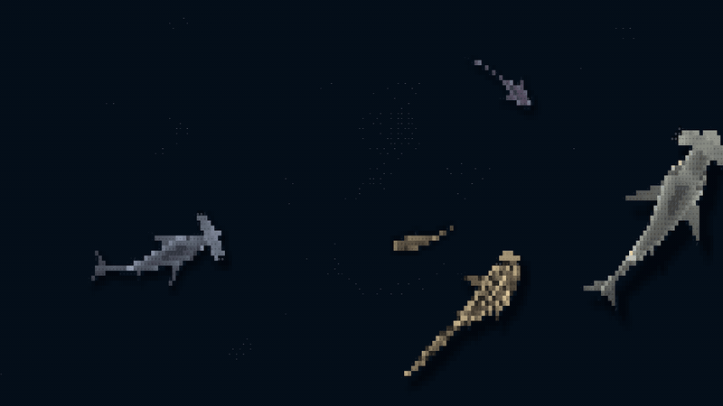
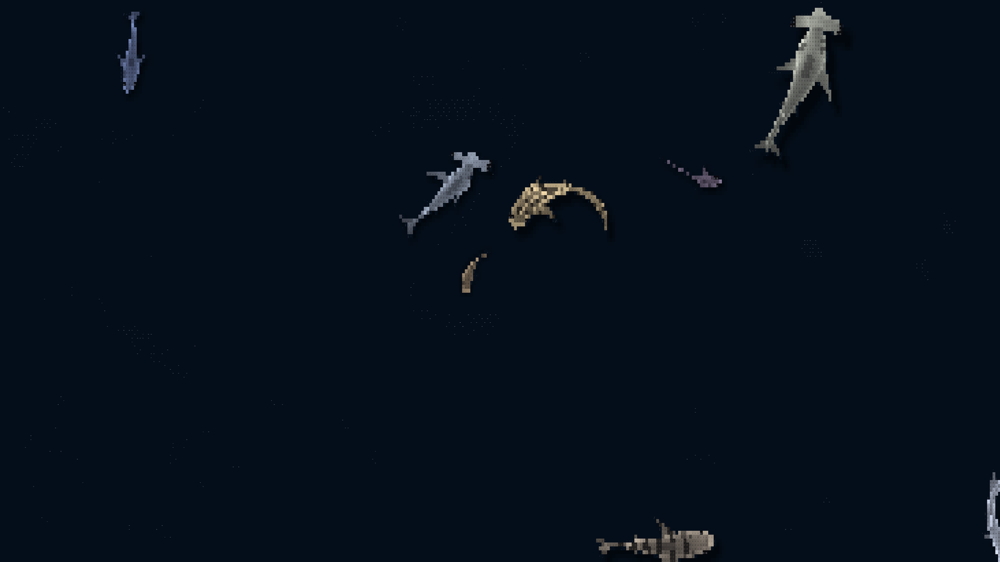
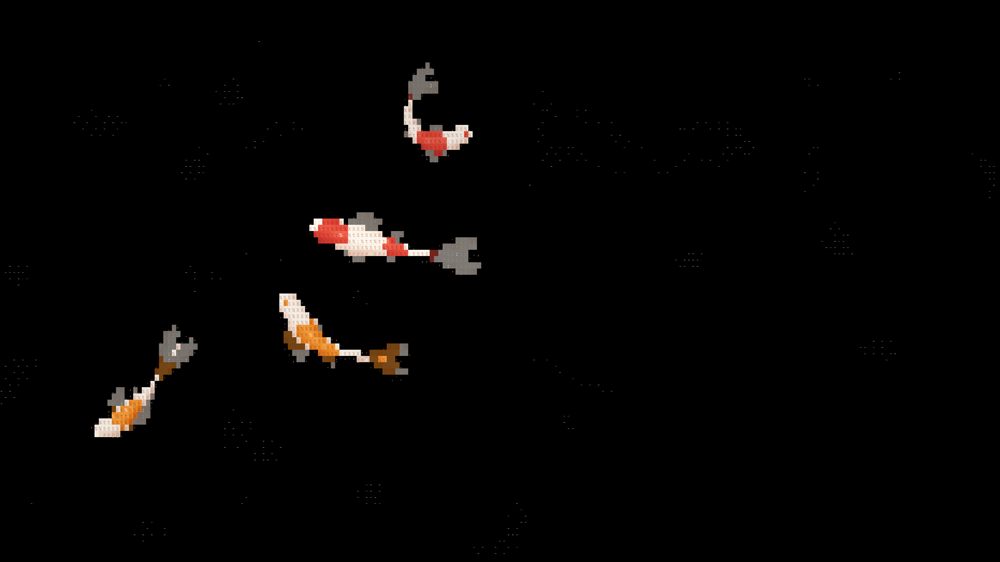
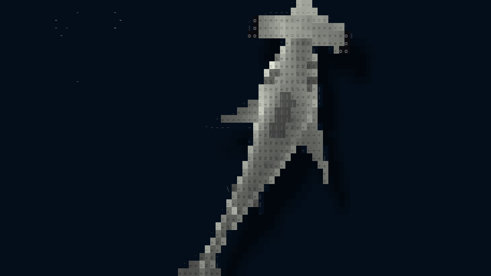

# ascii-aquarium

[ascii-sharks](https://github.com/stackedlol/ascii-sharks) (stackedlol) and
[ascii-koi](https://github.com/Ahmet-Dedeler/ascii-koi) (Ahmet Dedeler, MIT),
ported from a browser canvas to Rust and drawn in a fullscreen GPUI window, as
a scene in the Omarchy shader screensaver's rotation.

All credit for the scenes, their simulation and their look goes to those two
projects; go see the originals.



**[Watch the 23-second video](docs/media/aquarium.mp4)**: sharks, then koi.

| Sharks | Koi |
| --- | --- |
|  |  |

Up close, a hammerhead is countershaded blocks with a density-ramp texture,
traced outlines and a soft shadow:



The media are rendered offline from the simulation (2560x1440, 30 fps) with
the same font, not screen-captured.

## Run

```sh
./install.sh                        # builds ~/.local/bin/ascii-aquarium
ascii-aquarium sharks               # all eight kinds; any key, click or mouse move exits
ascii-aquarium koi --theme light    # upstream's paper-white pond
ascii-aquarium sharks --cast thresher,hammerhead,mako,nurse
```

`--cast` takes upstream's `?sharks=` / `?koi=` lists (first is biggest);
without it the sharks are the full cast (classic, hammerhead, zebra, tiger,
greathammer, mako, thresher, nurse) and the koi upstream's four;
`--max-fps` caps the frame rate (the simulation always steps at 60 Hz).

It is a [screensaver-rotation](https://github.com/igouss/screensaver-rotation)
runner: `install.sh` links it in as `aquarium`, `--list` names its scenes, and
when one comes up the rotation runs it with
`--app-id org.omarchy.screensaver --seed <n> --log <run log> <scenes...>`; the
first scene it knows plays. That mode hides the pointer, stops when focus leaves or the session locks,
stops the other monitors' instances, and logs `showing` / `stopped` lines the
rotation reads. That session logic is
[screensaver-session](https://github.com/igouss/screensaver-session), shared
with the other runners.

## How it draws

The originals draw a grid of ASCII cells on a canvas; so does this. Each frame
the simulation (fish boids, predator steering, 60 Hz fixed step) is
rasterised onto cells: five samples per cell against each body and fin shape,
fully covered cells as a shaded block with a dense glyph, partly covered ones
as a light edge glyph. Sharks depart from upstream's look toward
realism: countershaded backs instead of a lit tube, density-ramp glyphs
instead of letters, no rainbow accents, outline strokes that follow the
silhouette, sunlight caustics drifting over their backs, and soft shadows on
navy water instead of black. Fish are `-`, wake ripples `·`, kills `*`. The window
paints a quad per run of a block colour in a row and each non-blank cell as a
glyph shaped once per grid, since each frame's text is new and shaping it
every frame cost more than the simulation. Koi cells follow upstream,
`round(width / 150)` px wide; shark cells are about half upstream's,
`round(width / 366)` clamped to 5-7 px, so the bodies have room for detail.
Both are 1.45 times as tall as wide.

## Layout

- `src/domain`: the simulation and renderers, no I/O (`pond`, `shark`,
  `koi`, `*_skin`, `water`, `raster`, `scene`), and the dismissal policy
  shared with commit-screensaver (`input`, `focus`).
- `src/app.rs`: `Session`, a scene on the host's clock, and the focus watch.
- `src/adapters`: the GPUI window, Hyprland presence and pointer, sibling
  shutdown, the run log.

Gates: `cargo clippy --all-targets -- -D warnings`, `cargo test`, and the
5000-token per-file commit budget.
